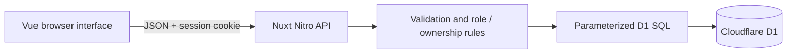
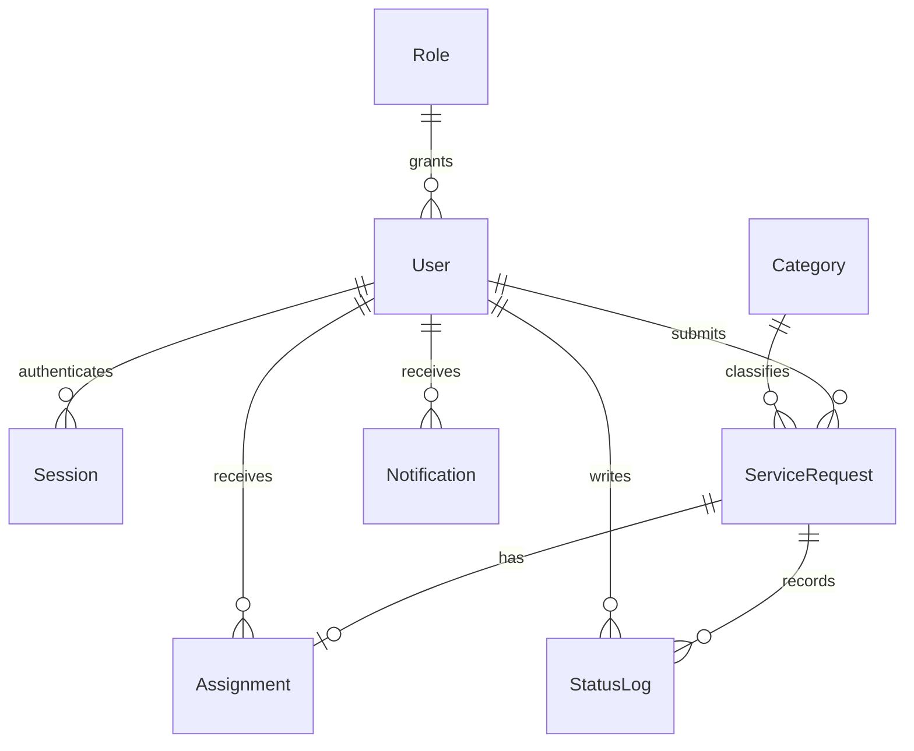

# Architecture

CampusFix uses one Nuxt application. Vue renders forms and role-specific views. Nitro exposes REST endpoints. Bound SQL statements access Cloudflare D1. The Prisma schema remains the relational model and SQL migration source. A browser cookie identifies a server-side session. Requests are authorized using the database user's current role and active flag on every API call.

Roles have many users; users belong to one role. Categories and requesters each have many requests. A request has at most one current assignment, enforced by a unique requestId. Reassignment replaces that current officer while adding a status log and audit entry. A request has many status logs; each log belongs to one actor. Sessions and notifications belong to one user. Audit deliberately stores actor and target identifiers without cascading foreign keys, retaining evidence after request deletion. Status logs cascade on request deletion; the audit action survives.

Workflow: OPEN -> ASSIGNED -> IN_PROGRESS -> COMPLETED. Admin may cancel any nonterminal request. Terminal requests cannot be reassigned or reopened. Students/staff can edit/delete only their own OPEN requests. An administrator can delete any request after confirmation. Search is scoped before filtering and pagination, preventing another user's requests from appearing in counts.
